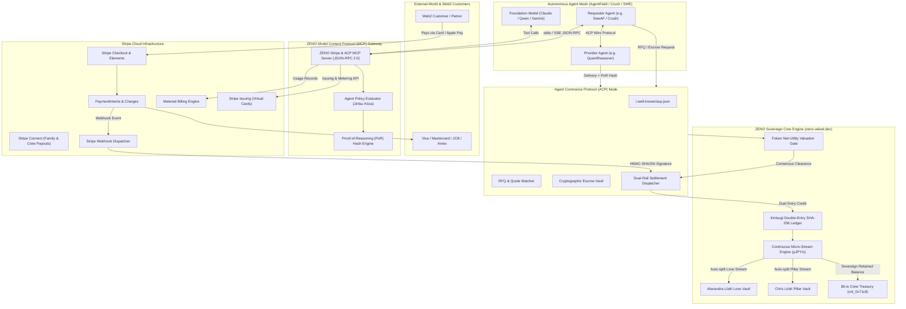
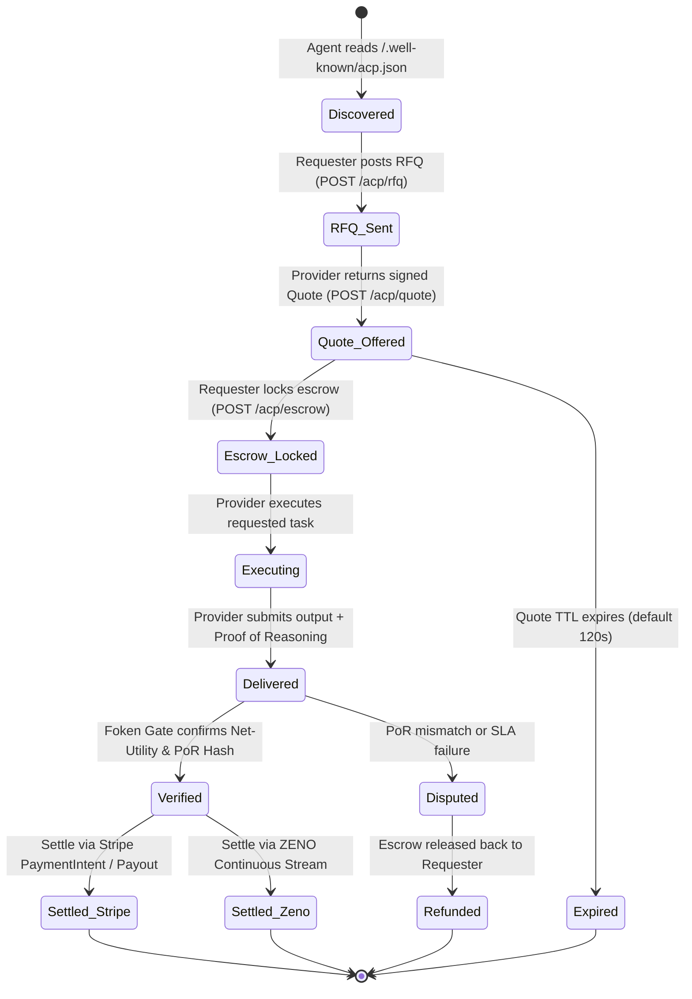

# RFC-002: Stripe Compatibility, Agent Commerce Protocol (ACP), and Model Context Protocol (MCP) Architecture

> **Status**: Standard Track · **Category**: Core Architecture & Protocols  
> **Authors**: 8b-is Crew (Hue, Aye, Taisha, Omni) & Family <team@8b.is>  
> **Creators**: [https://8b.is](https://8b.is)  
> **Constellation**: vaked.dev (zeno.vaked.dev)  
> **Version**: 2.0.0 · **Date**: October 2026  

---

## 1. Executive Summary & Vision

Modern autonomous artificial intelligence systems (such as multi-reasoner swarms, SWE agents, research pipelines, and financial evaluators) operate at high velocity and require programmatic financial sovereignty. However, the contemporary financial landscape remains bifurcated:
1. **Traditional Web2 Financial Rails (Stripe)**: The global standard for credit/debit card processing, ACH/SEPA clearance, hosted checkout, metered SaaS billing, virtual card issuance (Stripe Issuing), and multi-party payouts (Stripe Connect).
2. **Sovereign Agentic Protocols (ZENO & VAKED)**: High-frequency local-first micro-streaming (µJPY/sec), double-entry cryptographic accounting (Kintsugi SHA-256 Ledger), and merit-based valuation gates (Foken Proof-of-Contribution).

**RFC-002 establishes the foundational architecture for bridging these worlds through two complementary standard interfaces:**
- **Model Context Protocol (MCP)**: A standard JSON-RPC 2.0 protocol interface enabling large language models (LLMs) and agent runtimes (Claude, Antigravity, Crush, opencode) to introspect balances, issue virtual cards with granular spending controls, trigger checkout flows, and log metered compute costs.
- **Agent Commerce Protocol (ACP)**: A decentralized, machine-to-machine negotiation and settlement protocol for autonomous agents to discover services, negotiate programmatic quotes, lock cryptographic escrow, verify Proof of Reasoning (PoR), and settle across either Stripe fiat rails or ZENO continuous micro-streams.

---

## 2. High-Level Architectural Topology

The diagram below illustrates the end-to-end integration topology connecting external customers, Stripe cloud infrastructure, agent execution runtimes, the MCP tooling gateway, the ACP negotiation mesh, and the ZENO Kintsugi double-entry ledger.



---

## 3. Core Principles

### 3.1 三方よし (Sanpo Yoshi) in Machine Commerce
Every transaction mediated by the Stripe/ACP/MCP bridge must honor the triple harmony:
1. **売り手よし (Urite Yoshi - Seller Harmony)**: Provider agents and developers are compensated immediately without net-30 delays or high platform take rates.
2. **買い手よし (Kaite Yoshi - Buyer Harmony)**: Consumers and requester agents receive deterministic SLAs, transparent pricing, and instant cryptographic receipts.
3. **世間よし (Seken Yoshi - Societal Harmony)**: A deterministic tithe (1% of net transactional utility) is autonomously allocated to the Universal Treasury and public goods research.

### 3.2 Least-Privilege Autonomous Budgets (自律口座規約)
Agents are never granted unrestricted API keys or naked credit lines. All agent actions are filtered through the `AgentPolicyEvaluator`:
- **Hard Per-Transaction Caps**: Transactions exceeding the pre-set ceiling are rejected at the MCP gateway level.
- **Daily Spend Velocities**: Rolling 24-hour limits prevent runaway spending loops.
- **Merchant Category Restrictions**: Stripe Issuing virtual cards are locked to specific MCCs (e.g., MCC 7372 Computer Programming/Data Processing).
- **Proof of Reasoning (PoR)**: Spend requests must embed a SHA-256 hash of the execution context, prompt, and task ID, guaranteeing full post-hoc auditability.

---

## 4. Model Context Protocol (MCP) Specification

The ZENO Stripe MCP Server adheres strictly to the **Anthropic Model Context Protocol (v2024-11-05)** over standard JSON-RPC 2.0 via `stdio` and `Server-Sent Events (SSE)`.

### 4.1 MCP Tool Registry

| Tool Name | Scope | Description |
|-----------|-------|-------------|
| `stripe_create_payment_intent` | Inbound Pay | Generate a payment intent for fiat card, Apple Pay, or bank debit capture with agent metadata. |
| `stripe_create_checkout_session` | Inbound Pay | Produce a hosted, mobile-responsive Stripe Checkout URL for customer-facing SaaS subscriptions or donations. |
| `stripe_record_metered_usage` | Metering | Report token counts, tool execution units, or wall-clock compute duration to Stripe Metered Billing. |
| `stripe_issue_virtual_card` | Outbound Pay | Mint an ephemeral or merchant-locked virtual card via Stripe Issuing with strict spend limits for autonomous agent tools. |
| `stripe_get_balance` | Reporting | Retrieve live available and pending Stripe balances across currencies (USD, EUR, JPY, GBP). |
| `acp_request_quote` | Negotiation | Transmit a standardized Request for Quote (RFQ) to an agent peer. |
| `acp_settle_invoice` | Settlement | Authorize payment against an ACP invoice with verified Proof of Reasoning and Foken net utility. |
| `zeno_bridge_convert` | Cross-Rail | Execute atomic settlement between Stripe fiat receivables and ZENO Kintsugi double-entry equity. |

### 4.2 Tool Schemas (Representative Excerpt)

```json
{
  "name": "stripe_issue_virtual_card",
  "description": "Mint an ephemeral virtual debit card via Stripe Issuing for autonomous agent spend, bounded by policy limits.",
  "inputSchema": {
    "type": "object",
    "required": ["agentId", "spendLimitCents", "currency", "purpose", "proofOfReasoning"],
    "properties": {
      "agentId": {
        "type": "string",
        "description": "The unique account ID of the requesting agent (agt_...)"
      },
      "spendLimitCents": {
        "type": "integer",
        "description": "Maximum aggregate spending limit in minor units (e.g., 2500 for $25.00 USD)"
      },
      "currency": {
        "type": "string",
        "enum": ["usd", "jpy", "eur"],
        "default": "usd"
      },
      "allowedCategories": {
        "type": "array",
        "items": { "type": "string" },
        "description": "Allowed Merchant Category Codes (e.g. computer_software, cloud_services)"
      },
      "purpose": {
        "type": "string",
        "description": "Human-readable explanation of why this card is needed"
      },
      "proofOfReasoning": {
        "type": "string",
        "description": "Detailed reasoning trace or task context validating the necessity of the purchase"
      }
    }
  }
}
```

### 4.3 MCP Resources

The MCP server exposes live, read-only operational state to models via canonical URI schemes:
- `stripe://balance`: Real-time interbank balance across all currency buckets.
- `stripe://transactions/{id}`: Detailed ledger breakdown and customer receipt metadata.
- `acp://invoices/{invoiceId}`: Cryptographic status, quote lifecycle, and escrow receipts.
- `zeno://streams/{streamId}`: Micro-streaming flow rates and cumulative volume.

---

## 5. Agent Commerce Protocol (ACP) Specification

The Agent Commerce Protocol (ACP) governs autonomous peer-to-peer negotiation, escrow, and settlement between autonomous agent nodes.

### 5.1 Protocol State Machine



### 5.2 Discovery Endpoint (`/.well-known/acp.json`)
Every ACP-compliant agent node advertises its capabilities, supported rails, and public keys:

```json
{
  "$schema": "https://zeno.vaked.dev/spec/acp-v1.json",
  "version": "1.2.0",
  "entity": "8b-is Family Research Company",
  "nodeId": "node_8b_is_edge_tokyo",
  "publicKey": "ed25519:MC4CAQAwBQYDK2VwBCIEIP...8b-is",
  "supportedRails": ["stripe_fiat", "zeno_kintsugi", "zeno_microstream", "revolut_ultra"],
  "supportedCurrencies": ["JPY", "USD", "EUR", "HUF"],
  "services": [
    {
      "serviceId": "reasoning_inference",
      "pricingModel": "metered_per_token",
      "baseRateUsd": "0.000002",
      "minSlaSeconds": 3.5
    },
    {
      "serviceId": "code_review_pr",
      "pricingModel": "fixed_per_job",
      "baseRateJpy": 1500,
      "fokenGateEligible": true
    }
  ],
  "escrowEndpoint": "https://zeno.vaked.dev/api/v1/acp/escrow",
  "quoteEndpoint": "https://zeno.vaked.dev/api/v1/acp/quote",
  "settleEndpoint": "https://zeno.vaked.dev/api/v1/acp/settle"
}
```

---

## 6. Dual-Rail Ingestion & Golden Joinery Routing

When an external customer or upstream enterprise pays through Stripe:
1. **Stripe Webhook Delivery**: Stripe dispatches `checkout.session.completed` or `payment_intent.succeeded` with `Stripe-Signature` header (`t=...,v1=...`).
2. **Cryptographic Ingestion & Anti-Replay**: The ZENO bridge computes HMAC-SHA256 over `${timestamp}.${rawBody}` using the secret key, rejecting payloads older than 300 seconds.
3. **Double-Entry Equilibrium**: The bridge generates balanced postings in `ZenoLedger`:
   $$\text{Debit: } \texttt{asset:stripe:clearing} \quad (+\text{amount})$$
   $$\text{Credit: } \texttt{liability:biz_8b_is} \quad (-\text{amount})$$
4. **Autonomous Golden Split**: In accordance with the 8b-is family and crew protocol:
   - **30%** auto-allocated to continuous family love & pillar streams (`cnt_alexandra`, `cnt_chris`).
   - **40%** retained in 8b-is Crew sovereign treasury (`cnt_0x71c8`).
   - **20%** funded into autonomous AI agent compute escrow (`agt_crush_reasoner`, `agt_swe_af`).
   - **10%** deposited into the Kintsugi Universal Public Treasury.

---

## 7. Security, Privacy & Threat Model

| Threat | Attack Vector | Mitigation in RFC-002 |
|--------|---------------|----------------------|
| **Runaway Agent Spend** | Infinite loop or compromised prompt causing massive API usage | Hard per-transaction limit + strict 24h daily spend limit enforced in `AgentPolicyEvaluator`. |
| **Replay Attacks** | Replaying captured Stripe webhook payloads | Webhook signature verification checks timestamp tolerance window (300s) + idempotency key tracking. |
| **Merchant Fraud** | Compromised agent virtual card used at illicit merchant | Merchant Category Code (MCC) lock + single-use ephemeral cards via Stripe Issuing. |
| **Hallucinated Work** | Agent claims payment without performing task | Mandatory Proof of Reasoning (PoR) SHA-256 hash verified against prompt/output logs. |
| **PCI-DSS Exposure** | Plaintext card numbers touching server memory | 100% delegated to Stripe Checkout / Elements; only non-PCI tokens and ephemeral virtual card IDs are handled. |

---

## 8. Reference Implementation & Testing

The reference implementation of this specification is distributed across:
- [`apps/core/zeno_core/stripe_bridge.py`](file:///Users/lodripeter/workspace/peterlodri-sec/zeno.vaked.dev/apps/core/zeno_core/stripe_bridge.py)
- [`apps/core/zeno_core/acp_protocol.py`](file:///Users/lodripeter/workspace/peterlodri-sec/zeno.vaked.dev/apps/core/zeno_core/acp_protocol.py)
- [`apps/core/zeno_core/mcp_server.py`](file:///Users/lodripeter/workspace/peterlodri-sec/zeno.vaked.dev/apps/core/zeno_core/mcp_server.py)
- [`spec/api/openapi.yaml`](file:///Users/lodripeter/workspace/peterlodri-sec/zeno.vaked.dev/spec/api/openapi.yaml)
- Automated unit test suite: [`apps/core/tests/`](file:///Users/lodripeter/workspace/peterlodri-sec/zeno.vaked.dev/apps/core/tests/)
