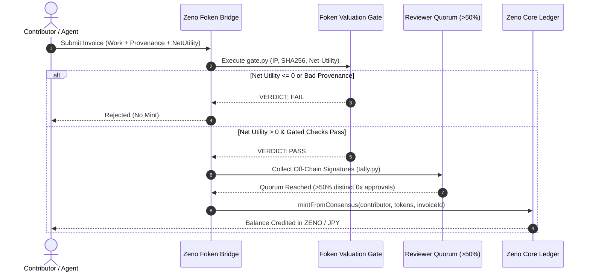

# RFC-001: ZENO Sovereign Neo-Bank Architecture

```
RFC:          001
Title:        ZENO — Japanese Proof-of-Contribution Sovereign Neo-Bank
Authors:      Péter Lódri <cabotage@pm.me> & VAKED Architecture Group
Status:       Standard Track
Category:     Core Architecture & Protocols
Created:      2026-10-11
Constellation: vaked.dev (zeno.vaked.dev)
```

---

## 1. Abstract

This specification defines **Zeno** (銭・禅・善), a sovereign neo-banking architecture rooted in Japanese merchant philosophy (*Sanpo Yoshi* 三方よし), spatial mindfulness (*Ma* 間), and immutable golden auditability (*Kintsugi* 金継ぎ). 

Zeno synthesizes the zero-copy, edge-first infrastructure of the **VAKED Constellation** with the proof-of-contribution valuation gate of **Foken**. Rather than expanding money supply through speculative debt, Zeno anchors balance expansion in verified net utility:
$$\text{Net Utility} = \text{Future Work Avoided} - (\text{Work Added} + 1.5 \times \text{Maintenance Debt})$$

Zeno natively supports four account classes: Personal (個人), Guild (組合), Contributor (貢献者), and Autonomous AI Agent (自律エージェント). It introduces continuous-time micro-streaming ($\mu\text{JPY/sec}$) and full compliance posture under the Japanese Payment Services Act (資金決済法).

---

## 2. Terminology & Core Invariants

### 2.1 Terminology
- **Zeno Core Ledger**: An immutable, cryptographically chained, double-entry ledger.
- **Kintsugi Seal**: A SHA-256 block hash linking sequential transactions with golden witness receipts.
- **Zeni (銭)**: The native accounting unit (1 ZENO = 1 JPY = $10^6\,\mu\text{JPY}$).
- **Foken Gateway**: An off-chain verification filter validating contribution invoices against IP assignment, artifact provenance, and net-utility thresholds.
- **Micro-Stream**: An open continuous settlement pipe between two accounts governed by a deterministic flow rate ($r = \Delta v / \Delta t$).
- **Agent Policy**: Cryptographic execution boundaries assigned to autonomous AI agent accounts.

### 2.2 Core Invariants
1. **Double-Entry Equilibrium**: For every transaction $T$:
   $$\sum_{i} \text{Debit}_i = \sum_{j} \text{Credit}_j$$
2. **Cryptographic Lineage**: For block $n \ge 1$:
   $$H_n = \text{SHA256}(H_{n-1} \,\|\, T_n \,\|\, \text{Timestamp})$$
3. **No Debt Minting**: New ZENO or JPY-credit tokens are minted solely upon verified fiat deposit or consensus-passed Foken contribution invoices.
4. **Deterministic Solvency**: Account balances may not drop below zero unless governed by a pre-collateralized Mujin mutual liquidity contract.

---

## 3. Account Hierarchy

```
                      Universal Treasury (UT)
                     /           |           \
                    /            |            \
        Personal (個人)   Guild (組合)   Agent (自律)
              \                  |            /
               \                 |           /
              Contributor Accounts (貢献者)
```

1. **Personal Accounts (`usr_...`)**:
   - Held by verified human individuals.
   - Protected by WebAuthn passkeys (Ed25519) and zero-knowledge identity proofs.
2. **Guild Accounts (`gld_...`)**:
   - Multi-signature / threshold-cleared accounts for open-source teams, research labs, or studios.
   - Operates internal Mujin mutual liquidity pools.
3. **Contributor Accounts (`cnt_...`)**:
   - Directly linked to public cryptographic keys (`0x...` or `ed25519...`).
   - Earns ZENO / JPY through verified Foken invoices.
4. **Autonomous AI Agent Accounts (`agt_...`)**:
   - Held by autonomous software agents (e.g., Crush, Enthea, SWE-agent, AgentField reasoners).
   - Programmed with strict policy gates: daily expenditure ceiling, whitelist of recipient services, and mandatory proof-of-thought hash logging.

---

## 4. Continuous-Time Micro-Streaming Protocol

Rather than settling payroll or service fees monthly or bi-weekly, Zeno enables infinitesimal continuous settlement:

### 4.1 Balance Function
For an account receiving $k$ inbound streams and paying $m$ outbound streams:
$$B(t) = B(t_0) + \sum_{i=1}^k r_i \cdot (t - t_{0, i}) - \sum_{j=1}^m s_j \cdot (t - t_{0, j})$$
where:
- $r_i$ is the flow rate of inbound stream $i$ in $\mu\text{JPY/sec}$.
- $s_j$ is the flow rate of outbound stream $j$ in $\mu\text{JPY/sec}$.
- $t$ is the current UNIX epoch timestamp in milliseconds.

Streams update instantaneously on the client via high-frequency requestAnimationFrame interpolation, eliminating cognitive lag and cash-flow anxiety.

---

## 5. Foken Proof-of-Contribution Bridge

Zeno interfaces directly with the Foken valuation gate (`gate.py` / `tally.py`):



---

## 6. Japanese Regulatory Posture (資金決済法 Compliance)

Zeno is designed from inception to conform to the **Japanese Payment Services Act (資金決済法)** and **Banking Act (銀行法)**:
1. **Fund Transfer Service Provider Type II (第二種資金移動業)**:
   - Covers consumer remittances and account balances up to ¥1,000,000 per user.
   - Fully backed 100% by legal performance deposits (*Kyōtaku* 供託) or bank guarantee contracts under the Legal Affairs Bureau (法務局).
2. **Crypto-Asset / Electronic Payment Instrument (電子決済手段等取引業)**:
   - JPYC and digital yen token interfaces strictly separated into sovereign smart contracts and registered exchange gateways.
3. **AML / CFT & Travel Rule**:
   - Implements IVMS-101 messaging protocols with zero-knowledge identity proofs, protecting user privacy while fulfilling statutory verification mandates.

---

## 7. Edge & Fleet Infrastructure

Zeno is built to run on the VAKED edge infrastructure:
- **Cloudflare Workers / Pages**: Sub-10ms global edge delivery for UI and cryptographic signing.
- **NixOS Fleet**: Hardened microvm / systemd services hosted on `hetzner` / `dev-cx53` with sops-nix secret management.
- **Telemetry**: Exposes `/healthz` and `/beacon.json` compatible with constellation health monitors.
