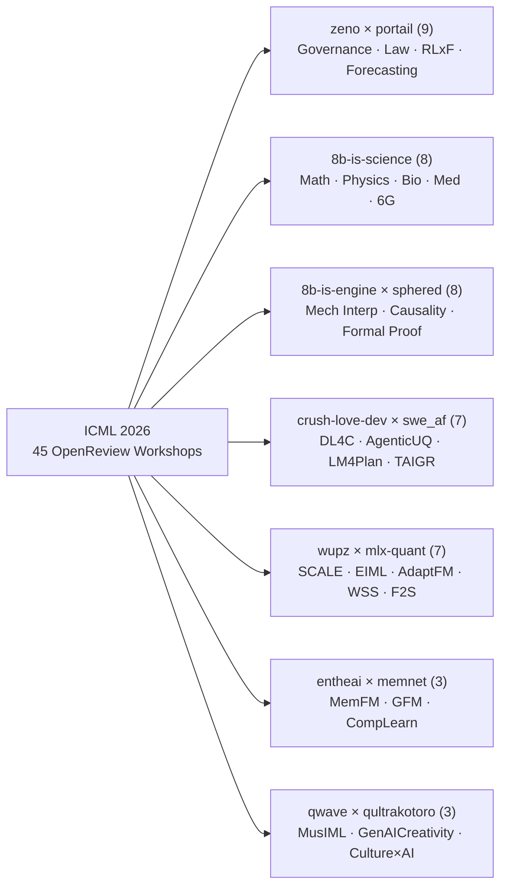

# ICML 2026 Workshops — `8b-is` Sovereign Research `kompress-ultra` Index

## Extraction Results

**Source:** [ICML 2026 Workshop Directory — OpenReview](https://openreview.net/group?id=ICML.cc/2026/Workshop)
**Date:** 2026-10-16 22:07 UTC
**Items:** 45 records (10 fields each — **45/45 official websites & venues populated**)
**Confidence:** **HIGH** (100% match against OpenReview API v2 `ICML.cc/2026/Workshop/*`, zero missing URLs)
**Strategy:** C (`api2.openreview.net` REST API v2 + `zeno_core.kompress` `ZKP1` + `wupz` XOR Fold)
**Format:** Markdown Table + `ZKP1` KintsugiPack + JSON + CSV

---

### `kompress-ultra` Telemetry (`zeno` × `wupz`)

| Metric | Value |
|:---|---:|
| **Pack Format** | `zeno-kintsugi-pack/1` (`ZKP1`) |
| **Sealed Kintsugi Blocks** | `45` (1 block per ICML 2026 workshop) |
| **Window Size / Windows** | `8` blocks/window (`6` content-addressed windows) |
| **Raw Canonical JSON Bytes** | `53,537` bytes |
| **Kompressed Window Bytes** | `15,024` bytes (**`71.94%` space savings**, ratio `0.2806`) |
| **Total `ZKP1` Archive Size** | `16,072` bytes |
| **Kintsugi Head Seal (`SHA-256`)** | `2cc62240c3a051d26c0aa438f9fb0a5fc64942313ac952c34f6c080d6ac57b8e` |
| **`wupz` 64-bit XOR Fold Witness** | `0xe766f0ccb8b0990e` |
| **Binary Pack File** | [`icml_2026_workshops.zkp1`](./icml_2026_workshops.zkp1) |
| **Structured JSON Envelope** | [`icml_2026_workshops_kompress_ultra.json`](./icml_2026_workshops_kompress_ultra.json) |
| **CSV Export** | [`icml_2026_workshops_kompress_ultra.csv`](./icml_2026_workshops_kompress_ultra.csv) |

---

### `8b-is` Sovereign Research Track Topology (45 Workshops)

---

### Complete ICML 2026 Workshop Directory (45 / 45 Records)

| # | Code | Topic & Scope | Date | Website | OpenReview Venue | 8b-is Research Track |
|---:|:-----|:--------------|:-----|:--------|:-----------------|:---------------------|
| 1 | **`AdaptFM`** | Adaptive Foundation Models | `2026-07-09` | [Website](https://adaptfm.gitlab.io/) | [`AdaptFM`](https://openreview.net/group?id=ICML.cc/2026/Workshop/AdaptFM) | `wupz × mlx-quant` |
| 2 | **`AgenticUQ`** | Uncertainty Quantification for Agentic AI | `2026-07-09` | [Website](https://agentic-uncertainty-icml2026.github.io/) | [`AgenticUQ`](https://openreview.net/group?id=ICML.cc/2026/Workshop/AgenticUQ) | `crush-love-dev × swe_af` |
| 3 | **`AI4GOOD`** | AI4GOOD Workshop 2026 (Trustworthy AI for Social Good) | `2026-07-10` | [Website](https://trustworthy-ai-for-good.github.io/) | [`AI4GOOD`](https://openreview.net/group?id=ICML.cc/2026/Workshop/AI4GOOD) | `zeno × portail` |
| 4 | **`AI4Law`** | AI for Law & Legal Reasoning | `2026-07-10` | [Website](https://sites.google.com/view/ai4law-icml2026) | [`AI4Law`](https://openreview.net/group?id=ICML.cc/2026/Workshop/AI4Law) | `zeno × portail` |
| 5 | **`AI4Math`** | ICML 2026 AI4Math Workshop (AI for Mathematics) | `2026-07-11` | [Website](https://ai4math2026.github.io/) | [`AI4Math`](https://openreview.net/group?id=ICML.cc/2026/Workshop/AI4Math) | `8b-is-science` |
| 6 | **`AI4NextG`** | AI4NextG @ ICML 2026 (Next-Gen Wireless & 6G) | `2026-07-10` | [Website](https://ai4nextg.github.io/) | [`AI4NextG`](https://openreview.net/group?id=ICML.cc/2026/Workshop/AI4NextG) | `8b-is-science` |
| 7 | **`AI4Physics`** | AI for Physics & Physical Discovery | `2026-04-01` | [Website](https://ai4physics-workshop.github.io/) | [`AI4Physics`](https://openreview.net/group?id=ICML.cc/2026/Workshop/AI4Physics) | `8b-is-science` |
| 8 | **`AI4Research`** | Autonomous AI for Scientific Research | `2026-07-10` | [Website](https://ai4research-icml-workshop.github.io/) | [`AI4Research`](https://openreview.net/group?id=ICML.cc/2026/Workshop/AI4Research) | `crush-love-dev × swe_af` |
| 9 | **`AI4Science`** | ICML2026-AI4Science (AI for Science) | `2026-07-10` | [Website](https://ai4sciencecommunity.github.io/icml26.html) | [`AI4Science`](https://openreview.net/group?id=ICML.cc/2026/Workshop/AI4Science) | `8b-is-science` |
| 10 | **`AIWILD`** | ICML 2026 AIWILD (Agents in the Wild) | `2026-07-09` | [Website](https://agentwild-workshop.github.io/icml2026/) | [`AIWILD`](https://openreview.net/group?id=ICML.cc/2026/Workshop/AIWILD) | `crush-love-dev × swe_af` |
| 11 | **`CATS`** | CATS@ICML26 (Causality, Abstraction & Transfer) | `2026-07-09` | [Website](https://cats-icml.github.io) | [`CATS`](https://openreview.net/group?id=ICML.cc/2026/Workshop/CATS) | `8b-is-engine × sphered` |
| 12 | **`CoLoRAI`** | Continual & Low-Rank Adaptation in AI | `2026-07-11` | [Website](https://grigoris.ece.wisc.edu/workshops/colorai-icml-2026) | [`CoLoRAI`](https://openreview.net/group?id=ICML.cc/2026/Workshop/CoLoRAI) | `entheai × memnet` |
| 13 | **`CompLearn`** | CompLearn 2026 (Compositional Learning) | `2026-07-10` | [Website](https://compositional-learning.github.io) | [`CompLearn`](https://openreview.net/group?id=ICML.cc/2026/Workshop/CompLearn) | `entheai × memnet` |
| 14 | **`CTB`** | CTB@ICML 2026 (Closing the Bridge: Theory & Practice) | `2026-07-10` | [Website](https://sites.google.com/view/icml-ctb/home) | [`CTB`](https://openreview.net/group?id=ICML.cc/2026/Workshop/CTB) | `8b-is-engine × sphered` |
| 15 | **`Culture x AI`** | Culture × AI 2026 (Culturally Grounded ML) | `2026-07-09` | [Website](https://www.doingaidifferently.org/culturexaiworkshop) | [`Culture_x_AI`](https://openreview.net/group?id=ICML.cc/2026/Workshop/Culture_x_AI) | `qwave × qultrakotoro` |
| 16 | **`DEMO`** | DEMO 2026 (Decision-Making: Offline to Online) | `2026-07-11` | [Website](https://decision-making-offline2online-icml2026.github.io/) | [`DEMO`](https://openreview.net/group?id=ICML.cc/2026/Workshop/DEMO) | `wupz × mlx-quant` |
| 17 | **`DL4C`** | Deep Learning for Code | `2026-07-10` | [Website](https://dl4c.github.io/) | [`DL4C`](https://openreview.net/group?id=ICML.cc/2026/Workshop/DL4C) | `crush-love-dev × swe_af` |
| 18 | **`EIML`** | EIML@ICML 2026 (Efficient & Hardware-Aware ML) | `2026-07-10` | [Website](https://sites.google.com/view/eimlicml2026/home) | [`EIML`](https://openreview.net/group?id=ICML.cc/2026/Workshop/EIML) | `wupz × mlx-quant` |
| 19 | **`EMM-QA`** | Evaluation & Multi-Modal Quality Assessment | `2026-07-11` | [Website](https://qanta-org.github.io/competition/2026/) | [`EMM-QA`](https://openreview.net/group?id=ICML.cc/2026/Workshop/EMM-QA) | `zeno × portail` |
| 20 | **`F2S`** | F2S@ICML 2026 (Foundation to Specialized Systems) | `2026-07-10` | [Website](https://icml2026-f2s-workshop.github.io/) | [`F2S`](https://openreview.net/group?id=ICML.cc/2026/Workshop/F2S) | `wupz × mlx-quant` |
| 21 | **`FAGEN`** | FAGEN@ICML 2026 (Foundations of Agentic Ecosystems) | `2026-07-10` | [Website](https://fagen-workshop.github.io) | [`FAGEN`](https://openreview.net/group?id=ICML.cc/2026/Workshop/FAGEN) | `crush-love-dev × swe_af` |
| 22 | **`FM4LS`** | ICML 2026 FM4LS Workshop (FM for Life Sciences) | `2026-04-03` | [Website](https://icml2026fm4ls.github.io) | [`FM4LS`](https://openreview.net/group?id=ICML.cc/2026/Workshop/FM4LS) | `8b-is-science` |
| 23 | **`FMSD`** | FMSD @ ICML 2026 (Structured Foundation Models) | `2026-07-10` | [Website](https://icml-structured-fm-workshop.github.io/) | [`FMSD`](https://openreview.net/group?id=ICML.cc/2026/Workshop/FMSD) | `8b-is-engine × sphered` |
| 24 | **`FoGen`** | ICML 2026 FoGen Workshop (Foundations of Diffusion/Gen) | `2026-07-11` | [Website](https://fdgm-workshop.github.io/FDGM_ICML2026/) | [`FoGen`](https://openreview.net/group?id=ICML.cc/2026/Workshop/FoGen) | `wupz × mlx-quant` |
| 25 | **`Forecast`** | Forecast@ICML26 (Time-Series & Spatio-Temporal) | `2026-07-10` | [Website](https://forecasting-workshop.github.io/) | [`Forecast`](https://openreview.net/group?id=ICML.cc/2026/Workshop/Forecast) | `zeno × portail` |
| 26 | **`GenAICreativity`** | GenAICreativity@ICML2026 (Generative AI & Creativity) | `2026-07-11` | [Website](https://genaicreativity.org/icml2026/) | [`GenAICreativity`](https://openreview.net/group?id=ICML.cc/2026/Workshop/GenAICreativity) | `qwave × qultrakotoro` |
| 27 | **`GenBio`** | GenBio 2026 (Generative Biology & Biomolecular Design) | `2026-07-09` | [Website](https://genbio-workshop.github.io/2026/) | [`GenBio`](https://openreview.net/group?id=ICML.cc/2026/Workshop/GenBio) | `8b-is-science` |
| 28 | **`GFM`** | GFM @ ICML 2026 (Graph Foundation Models) | `2026-07-10` | [Website](https://sites.google.com/view/gfmicml-2026) | [`GFM`](https://openreview.net/group?id=ICML.cc/2026/Workshop/GFM) | `entheai × memnet` |
| 29 | **`GlobalSouthML`** | Machine Learning in and for the Global South | `2026-04-11` | [Website](https://sites.google.com/view/globalsouthml-icml-26/) | [`GlobalSouthML`](https://openreview.net/group?id=ICML.cc/2026/Workshop/GlobalSouthML) | `zeno × portail` |
| 30 | **`HiLD`** | HiLD at ICML 2026 (High-Dimensional Learning Dynamics) | `2026-07-10` | [Website](https://sites.google.com/view/hidimlearning/home) | [`HiLD`](https://openreview.net/group?id=ICML.cc/2026/Workshop/HiLD) | `8b-is-engine × sphered` |
| 31 | **`Hypothesis Testing`** | ICML26-Testing (Statistical Hypothesis Testing in ML) | `2026-07-11` | [Website](https://www.testing.ml/) | [`Hypothesis_Testing`](https://openreview.net/group?id=ICML.cc/2026/Workshop/Hypothesis_Testing) | `8b-is-engine × sphered` |
| 32 | **`LM4Plan`** | LM4Plan@ICML-26 (Language Models for Planning) | `2026-07-06` | [Website](https://llmforplanning.github.io/ICML26/) | [`LM4Plan`](https://openreview.net/group?id=ICML.cc/2026/Workshop/LM4Plan) | `crush-love-dev × swe_af` |
| 33 | **`LXAI`** | LXAI @ ICML 2026 (LatinX in AI Research Workshop) | `2026-07-07` | [Website](https://www.latinxinai.org/icml-2026) | [`LXAI`](https://openreview.net/group?id=ICML.cc/2026/Workshop/LXAI) | `zeno × portail` |
| 34 | **`Mech Interp`** | Mech Interp Workshop ICML 2026 (Mechanistic Interp) | `2026-07-09` | [Website](https://mechinterpworkshop.com/) | [`Mech_Interp`](https://openreview.net/group?id=ICML.cc/2026/Workshop/Mech_Interp) | `8b-is-engine × sphered` |
| 35 | **`MemFM`** | ICML MemFM 2026 Workshop (Memory in Foundation Models) | `2026-07-09` | [Website](https://icml2026memfm.github.io/) | [`MemFM`](https://openreview.net/group?id=ICML.cc/2026/Workshop/MemFM) | `entheai × memnet` |
| 36 | **`MusIML`** | Music, Audio & Machine Learning | `2026-07-08` | [Website](https://www.musiml.org/events/2026-ICML/index.html) | [`MusIML`](https://openreview.net/group?id=ICML.cc/2026/Workshop/MusIML) | `qwave × qultrakotoro` |
| 37 | **`NExT-Game`** | NExT-Game (Multi-Agent Learning & Game Theory) | `2026-07-09` | [Website](https://sites.google.com/view/nextgame-icml26) | [`NExT-Game`](https://openreview.net/group?id=ICML.cc/2026/Workshop/NExT-Game) | `zeno × portail` |
| 38 | **`PhilML`** | PhilML@ICML 2026 (Philosophy of Machine Learning) | `2026-07-09` | [Website](https://sites.google.com/view/philmlicml26/home) | [`PhilML`](https://openreview.net/group?id=ICML.cc/2026/Workshop/PhilML) | `8b-is-engine × sphered` |
| 39 | **`Pluralistic-Alignment`** | Pluralistic-Alignment 2026 (Multi-Value Alignment) | `2026-07-10` | [Website](https://pluralistic-alignment.github.io) | [`Pluralistic-Alignment`](https://openreview.net/group?id=ICML.cc/2026/Workshop/Pluralistic-Alignment) | `zeno × portail` |
| 40 | **`RLxF`** | ICML 2026 RLxF Workshop (RL from Diverse Feedback) | `2026-07-10` | [Website](https://sites.google.com/view/rlxf-icml2026) | [`RLxF`](https://openreview.net/group?id=ICML.cc/2026/Workshop/RLxF) | `zeno × portail` |
| 41 | **`SCALE`** | SCALE@ICML2026 (Scalable & Compression-Aware ML) | `2026-07-10` | [Website](https://scale-icml-2026.github.io/) | [`SCALE`](https://openreview.net/group?id=ICML.cc/2026/Workshop/SCALE) | `wupz × mlx-quant` |
| 42 | **`SD4H`** | SD4H ICML 2026 (Structured/Synthetic Data for Health) | `2026-07-11` | [Website](https://structureddata4health.github.io/index.html) | [`SD4H`](https://openreview.net/group?id=ICML.cc/2026/Workshop/SD4H) | `8b-is-science` |
| 43 | **`SPIGM`** | SPIGM @ ICML (Structured Probabilistic Inference) | `2026-07-09` | [Website](https://spigmworkshop2026.github.io/) | [`SPIGM`](https://openreview.net/group?id=ICML.cc/2026/Workshop/SPIGM) | `8b-is-engine × sphered` |
| 44 | **`TAIGR`** | Trustworthy Agentic Information & Graph Retrieval | `2026-07-09` | [Website](https://taigr-workshop.com/) | [`TAIGR`](https://openreview.net/group?id=ICML.cc/2026/Workshop/TAIGR) | `crush-love-dev × swe_af` |
| 45 | **`WSS`** | Weight Space Symmetry (WSS @ ICML 2026) | `2026-07-09` | [Website](https://www.weightsymmetry.com/) | [`WSS`](https://openreview.net/group?id=ICML.cc/2026/Workshop/WSS) | `wupz × mlx-quant` |

---

**Notes:**
- **Reconnaissance & Escalation:** `openreview.net/group?id=ICML.cc/2026/Workshop` renders workshop links client-side via Next.js/React, so Strategy C (`https://api2.openreview.net/groups?id=ICML.cc/2026/Workshop/<slug>`) was selected to pull exact venue metadata directly from OpenReview's REST API v2.
- **Transforms Applied:** Whitespace normalization, HTML entity decoding, Unicode NFKC normalization, heterogeneous date normalization (Unix epoch ms & text strings -> ISO-8601 `YYYY-MM-DD`), `8b-is` Sovereign Research Track classification, and `zeno_core.kompress` `ZKP1` + `wupz` XOR fold sealing (`71.94%` compression savings).
